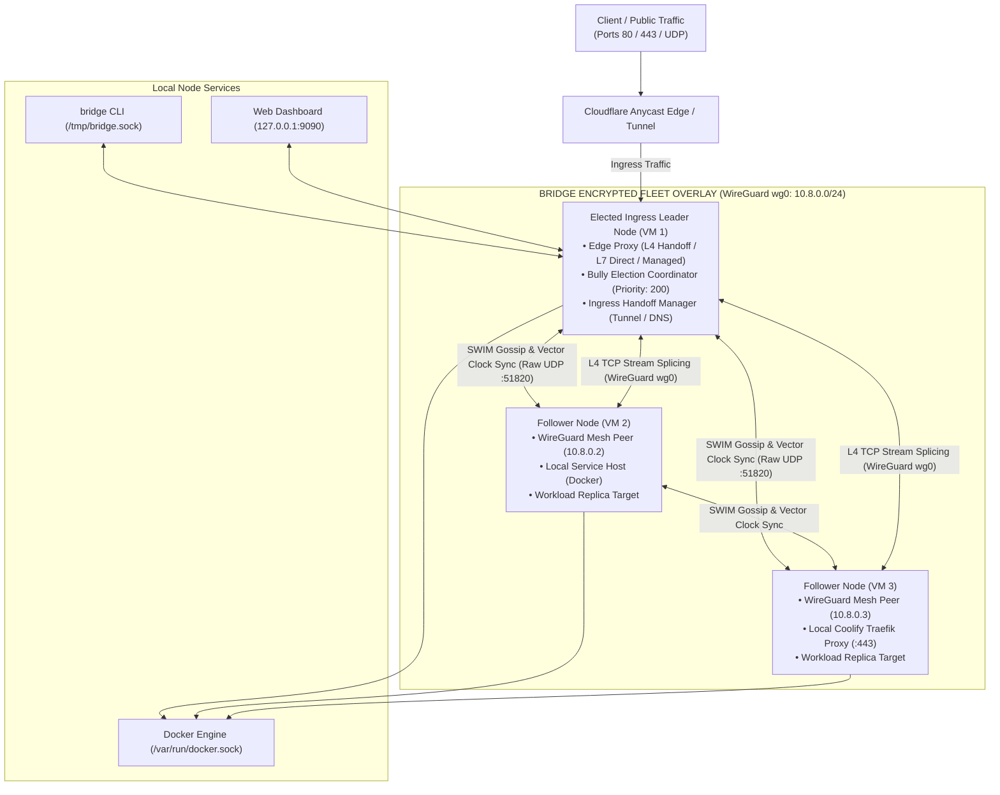

# BRIDGE System Architecture Documentation

> **Decentralized, Self-Healing Edge Ingress Mesh for Heterogeneous Cloud Fleets**  
> Verified implementation architecture reverse-engineered from source code, runtime tests, and infrastructure definitions.

---

## 1. System Purpose & Scope

**BRIDGE** is a lightweight, zero-external-dependency daemon deployed across multi-cloud VPS fleets (e.g., Hetzner, DigitalOcean, Vultr, AWS, bare-metal). It creates a unified, self-organizing ingress fabric that connects external client requests to containerized workloads (Docker, Coolify, Traefik, systemd services) without requiring centralized load balancers, etcd clusters, or manual reverse proxy reconfiguration.

### Key Architectural Tenets
1. **Zero Single Point of Failure (SPOF):** Control plane operations (failure detection, leader election, route distribution) are fully decentralized.
2. **Transparent Ingress Handoff (L4 SNI):** By peeking the TLS ClientHello SNI without terminating TLS, Bridge forwards traffic transparently to destination VM proxies without holding customer SSL certificates or private keys.
3. **Encrypted Overlay Mesh:** Inter-node communication travels through private point-to-point tunnels over Linux kernel WireGuard (`wg0` on `10.8.0.0/24`).
4. **Sub-Second Epidemic Failure Detection:** Powered by the SWIM protocol (`foca`) over raw UDP.
5. **Split-Brain Resilient Consensus:** Bully leader election enforced by strict dynamic majority quorum verification ($\lfloor n/2 \rfloor + 1$).
6. **Autonomic Workload Migration:** If a server fails, the elected ingress leader coordinates container duplication on surviving nodes, with configurable failback policies.

---

## 2. High-Level System Architecture

---

## 3. Architecture Documentation Navigation Index

This documentation set is organized into modular views adhering to the C4 model and industry-standard architecture practices:

### Master Views
* **[View K: Unified, Full-System Architecture Diagram](unified_system_architecture.md):** Consolidates all subsystems, decision gates, communication paths, and external dependencies into one comprehensive view.
  * *Vector preview available:* [`unified_architecture.svg`](unified_architecture.svg) (interactive zoomable SVG).

### Subsystem Architecture Views
* **[View A: System Context Architecture](view_a_system_context.md):** System boundary, external human actors, cloud dependencies (Cloudflare, Docker, Sentry, GitHub), and perimeter trust assumptions.
* **[View B: High-Level Container & Deployment Architecture](view_b_container_deployment.md):** Systemd daemon processes, networking topology, kernel interfaces (`wg0`), and cross-server communication units.
* **[View C: Internal Component Architecture](view_c_component_architecture.md):** Decomposition of the Rust workspace crates (`bridge`, `proxy`, `cluster`, `mesh`, `registry`), struct diagrams, and dependency directions.
* **[View D: End-to-End Data Flow](view_d_data_flow.md):** Request pathways for Mode 2 Handoff (L4), Mode 1 Direct (L7), Mode 3 Managed (Traefik Dynamic YAML), and L4 UDP proxying.
* **[View E: Control Flow and Decision Gates](view_e_control_flow_decision_gates.md):** Ingress connection branching decision trees, Bully leader election sequences, and failover duplication sequences.
* **[View F: State Machines and Distributed Coordination](view_f_state_machines_coordination.md):** Foca SWIM node health states (`Alive` / `Suspect` / `Down`), Bully candidate states, and failback cooldown machines.
* **[View G: Database and Persistence Architecture](view_g_persistence_architecture.md):** In-memory `ArcSwap` routing tables, `bridge-state.json` runtime checkpoints, and atomic configuration persistence.
* **[View H: API and Integration Architecture](view_h_api_integration.md):** Complete specifications for Unix domain socket IPC, Dashboard REST/WebSocket APIs, Docker Engine client, and Cloudflare integrations.
* **[View I: Security and Trust Boundaries](view_i_security_trust_boundaries.md):** WireGuard ChaCha20-Poly1305 encryption, Linux ambient capabilities (`CAP_NET_ADMIN`, `CAP_NET_BIND_SERVICE`), Argon2id password hashing, and zero TLS decryption.
* **[View J: Deployment, Operations, and Failure Architecture](view_j_operations_failure.md):** CI/CD release pipeline, static musl binaries, health checks, graceful shutdown coordination, and failure recovery matrices.

### Quality, Evidence & Maintenance Registers
* **[Architecture Evidence Register](evidence_register.md):** Comprehensive traceability matrix linking every architectural claim to exact source files, struct/fn names, line ranges, and test verifications.
* **[Documentation-to-Code Reconciliation Report](documentation_reconciliation.md):** Rigorous analysis classifying all discrepancies between historical documentation and the actual implementation (Verified, Partially Verified, Contradicted, Undocumented, Unimplemented).
* **[Architecture Decision and Uncertainty Register](decision_uncertainty_register.md):** Key design decisions established from code evidence, implementation ambiguities, unverified runtime assumptions, and recommended improvements.
* **[Navigation and Maintenance Guide](navigation_maintenance_guide.md):** Step-by-step instructions on navigating documentation, editing diagrams, and regenerating vector artifacts.

---

## 4. Major Architectural Findings & Verified Facts

1. **Layer 4 SNI Passthrough (Handoff Mode):** Default proxy mode extracts the TLS SNI without decrypting application data, forwarding TCP streams over WireGuard to the backend VM's local reverse proxy (Coolify/Traefik). Uses Tokio `copy_bidirectional` (not kernel `splice(2)`).
2. **Consistent Hashing Token Distribution:** Implements 360 virtual nodes per target node on a SHA-256 token ring (contrasting historical documentation claiming 128 virtual nodes).
3. **Adaptive Work-Stealing Concurrency:** Employs an elastic worker pool using `crossbeam-deque` that dynamically scales from 1 baseline worker up to `max_concurrency` ceiling when queue dwell latency exceeds 5ms.
4. **Split-Brain Quorum Protection:** Bully leader election requires majority coordinator acknowledgments ($\lfloor n/2 \rfloor + 1$) before assuming ingress leadership, preventing split-brain DNS updates during network partitions.
5. **Autonomic Self-Healing Configuration:** Automatically generates missing Curve25519 WireGuard keypairs on boot and dynamically persists discovered gossip peer seeds to `/etc/bridge/bridge.toml` using atomic filesystem renames.
