# View K: Unified, Full-System Architecture Diagram

## 1. Overview and Purpose

This is the **primary architectural map of BRIDGE**, consolidating all major applications, services, modules, control gates, data stores, distributed coordination protocols, and infrastructure integrations into one unified, navigable end-to-end representation.

A reviewer can begin at the system boundary, trace inbound client traffic through the decision gates and proxy layers, follow distributed consensus across the WireGuard mesh, and inspect local container orchestration without losing context.

---

## 2. Navigable Full-System Architecture Map

```mermaid
flowchart TD
    %% =========================================================================
    %% LAYER 1: EXTERNAL ACTORS & CLIENT INGRESS
    %% =========================================================================
    subgraph Layer1 ["1. EXTERNAL ACTORS & INGRESS SOURCES"]
        ClientUser["End-User Web Client\n(Browser / API Consumer / App)"]
        OperatorAdmin["Fleet Administrator / DevOps\n(Terminal CLI / Web Browser)"]
        CloudflareEdge["Cloudflare Anycast Network\n(Public Entrypoint / CDN)"]
    end

    %% =========================================================================
    %% LAYER 2: ENTRY POINTS & EDGE INTERFACES
    %% =========================================================================
    subgraph Layer2 ["2. ENTRY POINTS & EDGE INTERFACES"]
        Port443["TCP Listener :443\n(HTTPS Ingress)"]
        Port80["TCP Listener :80\n(HTTP Ingress)"]
        PortUDP["Generic UDP Listeners\n(Port :listen_port)"]
        IpcSocket["Unix Domain Socket\n/tmp/bridge.sock (0750)"]
        DashboardHttp["Axum HTTP/WS Server\n127.0.0.1:9090"]
        CloudflaredTunnel["cloudflared Tunnel Child Process\n(Managed by TunnelManager)"]
    end

    %% =========================================================================
    %% LAYER 3: INGRESS PROXY & DISPATCH ENGINE
    %% =========================================================================
    subgraph Layer3 ["3. INGRESS PROXY & DISPATCH ENGINE (proxy crate)"]
        ElasticWorkerPool["Elastic Worker Pool\n(Crossbeam Deque + Queue Dwell Monitor)"]
        ModeGate{"ProxyMode Switch\nproxy.config.mode"}
        
        subgraph ModeDirectPath ["Mode 1: Direct Mode (L7 Reverse Proxy)"]
            HyperClient["Hyper HTTP/1.1 Client\n(Connection Pooling & Keep-Alive)"]
            HostExtract["Host Header Normalizer\n(lowercase & strip port)"]
        end

        subgraph ModeHandoffPath ["Mode 2: Handoff Mode (L4 SNI Passthrough)"]
            TlsPeek["Initial Packet Peek Buffer\n(4096 bytes / Record 0x16 0x03)"]
            SniExtractor["parse_tls_sni(&buf)\nExtract Hostname (No Decryption)"]
            HttpRedirectGate{"Plaintext HTTP &&\nredirect_http?"}
            Http301["Generate HTTP 301\nRedirect to HTTPS"]
            ProxyProtocolInjector["encode_proxy_v2\n(Prepend 16-byte PPv2 Header)"]
            StreamSplicer["tokio::io::copy_bidirectional\n(Asynchronous Userspace Pipe)"]
        end

        subgraph ModeManagedPath ["Mode 3: Managed Mode (Control Plane Only)"]
            TraefikYamlGen["generate_traefik_config\n(Exclude local node routes)"]
            TraefikFileSync["Atomic YAML Sync\n/data/coolify/proxy/dynamic/bridge.yaml"]
        end

        subgraph UdpProxyPath ["L4 UDP & QUIC Engine"]
            UdpSessionMgr["UDP Session Manager\n(spawn_session / 30s timeout)"]
            QuicDcidRouter["QUIC DCID Router\n(RFC 9000 Header Parser)"]
        end
    end

    %% =========================================================================
    %% LAYER 4: REGISTRY, HASH RING & ROUTING STATE
    %% =========================================================================
    subgraph Layer4 ["4. REGISTRY & ROUTING STATE (registry crate)"]
        DomainRegistry["DomainRegistry\n(arc_swap::ArcSwap<HashMap<String, Route>>)"]
        ConsistentHashRing["HashRing (360 vnodes per physical node)\nToken = SHA256(ClientIP + Domain)"]
        VectorClock["Lamport Vector Clocks\nRouteClock { origin_node, version }"]
        RouteMetricsStore["RouteMetrics\n(Atomic Requests/Errors + Latency FIFO)"]
    end

    %% =========================================================================
    %% LAYER 5: DISTRIBUTED CONSENSUS & OVERLAY MESH
    %% =========================================================================
    subgraph Layer5 ["5. DISTRIBUTED COORDINATION & MESH (cluster & mesh crates)"]
        RawUdpSocket["Raw UDP Cluster Socket (0.0.0.0:51820)\nBRDG Protocol Framing (4-byte Magic + Ver 1)"]
        
        subgraph SwimFailureDetection ["SWIM Failure Detector (foca)"]
            DirectProbe["Direct Heartbeat Pings (500ms probe period)"]
            IndirectProbe["Indirect Ping-Req Relay"]
            SuspectTimer["Suspect-to-Down Timer (1000ms)"]
            IncarnationTracker["Incarnation Monotonicity Tracker"]
        end

        subgraph BullyElectionSubsystem ["Bully Leader Election & Consensus"]
            RankComparator["Rank Evaluator: (priority, node_id)"]
            CandidateBroadcaster["Election / ElectionOk Broadcaster"]
            QuorumGuard{"Majority Quorum Check\n(1 + acks) >= (total/2) + 1"}
            LeaderBroadcaster["Coordinator / CoordinatorAck Broadcaster"]
            LeadershipWatch["watch::Sender<Option<PeerNode>>\n(Dynamic Leadership Signal)"]
        end

        subgraph WireGuardOverlayMesh ["WireGuard L3 Mesh (mesh crate)"]
            WgDeviceMgr["WireGuardDevice Manager\n(Interface wg0: 10.8.0.x/24)"]
            WGApiNetlink["defguard_wireguard_rs\n(Linux Netlink Kernel Sync)"]
            PeerTunnelTable["Peer AllowedIPs Table (/32 Routing)"]
        end

        subgraph RouteGossipSync ["Routing Table State Gossip"]
            DigestExchanger["RouteDigest Push-Pull Sync (Every 500ms, Fanout 3)"]
            LocalOnlyFilter["Local-Only Domain Filter\n(Excludes Leader Dashboard Route)"]
        end
    end

    %% =========================================================================
    %% LAYER 6: WORKLOAD FAILOVER & AUTONOMIC RECOVERY
    %% =========================================================================
    subgraph Layer6 ["6. WORKLOAD FAILOVER & AUTONOMIC RECOVERY (src/failover)"]
        WorkloadDuplicator["WorkloadDuplicator Engine\n(Reacts to MemberDown & MemberUp)"]
        PlacementStrategy{"Placement Strategy\n'ring' successor / 'leader' / node_id"}
        FailbackStateMachine{"Failback Mode\nPreemptive (10s) / NonPreemptive / Manual"}
        WorkloadCommandBus["ClusterMessage::SpawnWorkload\n(Remote Peer Workload Dispatch)"]
    end

    %% =========================================================================
    %% LAYER 7: HOST INTEGRATIONS & LOCAL RUNTIMES
    %% =========================================================================
    subgraph Layer7 ["7. HOST RUNTIMES & INTEGRATION BOUNDARIES"]
        DockerDaemon["Local Docker Engine Daemon\n/var/run/docker.sock"]
        DockerDiscovery["DockerDiscovery Event Stream\n(Labels: traefik.http.routers.*, coolify.domain)"]
        CoolifyTraefik["Coolify Local Traefik Proxy\n(:80 / :443 Container)"]
        HostApplications["Backend Application Containers\n(Local Docker Services)"]
        CloudflareDnsApi["Cloudflare DNS REST API v4\n(A-Record Updates via Token)"]
        StateFinalizerDisk["bridge-state.json\n(Runtime Snapshot on Teardown)"]
        ConfigDisk["/etc/bridge/bridge.toml\n(Atomic Seed & Key Persistence)"]
    end

    %% =========================================================================
    %% INTER-LAYER FLOW CONNECTIONS
    %% =========================================================================
    
    %% Ingress Flow
    ClientUser -->|"HTTPS (Port 443)"| Port443
    ClientUser -->|"HTTP (Port 80)"| Port80
    ClientUser -->|"UDP Datagrams"| PortUDP
    CloudflareEdge -->|"Tunnel Ingress"| CloudflaredTunnel
    CloudflaredTunnel -->|"Local Forwarding"| Port443

    OperatorAdmin -->|"CLI Admin Commands"| IpcSocket
    OperatorAdmin -->|"Web Dashboard Browser"| DashboardHttp

    Port443 --> ElasticWorkerPool
    Port80 --> ElasticWorkerPool
    PortUDP --> UdpSessionMgr

    ElasticWorkerPool --> ModeGate

    %% Mode Branches
    ModeGate -->|"Direct (L7)"| HostExtract
    HostExtract --> DomainRegistry
    DomainRegistry --> HyperClient
    HyperClient -->|"HTTP Request"| HostApplications

    ModeGate -->|"Handoff (L4)"| TlsPeek
    TlsPeek --> SniExtractor
    SniExtractor -->|"SNI Matched"| DomainRegistry
    SniExtractor -->|"Plaintext HTTP"| HttpRedirectGate
    HttpRedirectGate -->|"Yes"| Http301
    Http301 --> ClientUser
    HttpRedirectGate -->|"No"| DomainRegistry

    DomainRegistry --> ConsistentHashRing
    ConsistentHashRing --> ProxyProtocolInjector
    ProxyProtocolInjector --> StreamSplicer

    StreamSplicer <-->|"L4 Stream over WireGuard wg0"| WgDeviceMgr
    StreamSplicer <-->|"L4 Stream to Local VM"| CoolifyTraefik
    CoolifyTraefik <--> HostApplications

    ModeGate -->|"Managed (Control)"| TraefikYamlGen
    DomainRegistry --> TraefikYamlGen
    TraefikYamlGen --> TraefikFileSync
    TraefikFileSync -->|"Hot-Reload via File Watcher"| CoolifyTraefik

    UdpSessionMgr --> QuicDcidRouter
    QuicDcidRouter --> WgDeviceMgr

    %% Control Plane & Gossip
    RawUdpSocket <--> SwimFailureDetection
    RawUdpSocket <--> BullyElectionSubsystem
    RawUdpSocket <--> RouteGossipSync

    SwimFailureDetection -->|"MemberEvent::Down"| BullyElectionSubsystem
    SwimFailureDetection -->|"MemberEvent::Down"| WorkloadDuplicator
    SwimFailureDetection -->|"MemberEvent::Up"| ConfigDisk

    BullyElectionSubsystem --> QuorumGuard
    QuorumGuard -->|"Quorum Verified"| LeadershipWatch

    LeadershipWatch -->|"Leader Promotion"| CloudflareDnsApi
    LeadershipWatch -->|"Leader Promotion"| CloudflaredTunnel
    LeadershipWatch -->|"Leader Promotion"| WorkloadDuplicator
    LeadershipWatch -->|"Leader Ingress Route"| DomainRegistry

    RouteGossipSync <-->|"Vector Clocks Diff"| VectorClock
    RouteGossipSync <--> DomainRegistry
    RouteGossipSync --> LocalOnlyFilter

    %% Failover & Orchestration
    WorkloadDuplicator --> PlacementStrategy
    PlacementStrategy -->|"Local Docker Spawn"| DockerDaemon
    PlacementStrategy -->|"Remote Dispatch"| WorkloadCommandBus
    WorkloadCommandBus --> RawUdpSocket
    WorkloadDuplicator --> FailbackStateMachine
    FailbackStateMachine --> DockerDaemon

    DockerDiscovery -->|"Stream Events"| DockerDaemon
    DockerDiscovery -->|"Discovered Routes"| DomainRegistry

    %% Host & Storage Integrations
    WgDeviceMgr --> WGApiNetlink
    WGApiNetlink --> PeerTunnelTable
    IpcSocket <--> DomainRegistry
    IpcSocket <--> BullyElectionSubsystem
    DashboardHttp <--> RouteMetricsStore
    DashboardHttp <--> BullyElectionSubsystem
    DashboardHttp <--> DomainRegistry

    Layer3 -.->|"Shutdown Signal"| StateFinalizerDisk
    DomainRegistry -.->|"Shutdown Snapshot"| StateFinalizerDisk
```

---

## 3. Subsystem Cross-References

Every region of this unified diagram is detailed in its dedicated architectural view:

* **Ingress Boundary & External Cloud Integrations:** Detailed in [View A: System Context](view_a_system_context.md).
* **OS Processes & Host Deployment Units:** Detailed in [View B: High-Level Container & Deployment Architecture](view_b_container_deployment.md).
* **Internal Rust Module Breakdown & Structs:** Detailed in [View C: Internal Component Architecture](view_c_component_architecture.md).
* **End-to-End Data Paths (Direct, Handoff, Managed, UDP):** Detailed in [View D: End-to-End Data Flow](view_d_data_flow.md).
* **Routing Decision Gates & Election Sequences:** Detailed in [View E: Control Flow and Decision Gates](view_e_control_flow_decision_gates.md).
* **Bully Quorum & SWIM State Transitions:** Detailed in [View F: State Machines and Distributed Coordination](view_f_state_machines_coordination.md).
* **State Checkpoints & Disk Serialization:** Detailed in [View G: Database and Persistence Architecture](view_g_persistence_architecture.md).
* **API Schemas (IPC, REST, WS, Docker, WireGuard):** Detailed in [View H: API and Integration Architecture](view_h_api_integration.md).
* **Security & Cryptographic Trust Boundaries:** Detailed in [View I: Security and Trust Boundaries](view_i_security_trust_boundaries.md).
* **CI/CD, Packaging, and Recovery Matrix:** Detailed in [View J: Deployment, Operations, and Failure Architecture](view_j_operations_failure.md).
