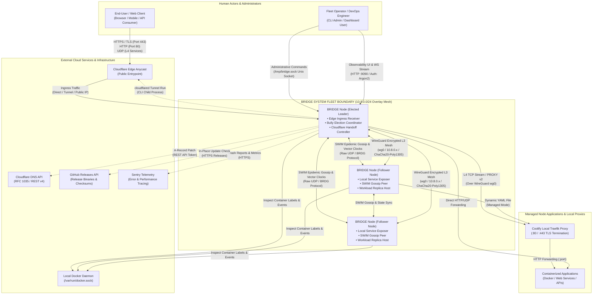

# View A: System Context Architecture

## 1. System Boundary and Purpose

**BRIDGE** is a distributed, fault-tolerant edge mesh proxy, service discoverer, and failover orchestrator for multi-cloud and bare-metal VPS fleets.

Its primary purpose is to transform a cluster of heterogeneous Linux servers running containerized workloads (such as Docker, Coolify, Traefik, or native systemd services) into a single, self-healing, unified ingress fabric. Inbound traffic reaching any entry point in the fleet is dynamically routed to the appropriate backend service across an encrypted WireGuard overlay mesh, with automatic leader failover and container replica migration upon server failure.

---

## 2. System Context Diagram

---

## 3. Boundary Components & External Interfaces

### 3.1 External Actors
* **End-User / Client Applications:** Send HTTP, HTTPS (TLS), and generic UDP datagrams targeting fleet-hosted domains (e.g. `app.example.com`, `api.example.com`).
* **Fleet Operator / Administrator:** Interacts with the daemon locally via the administrative CLI (`bridge` commands over Unix Domain Socket) or through the browser via the embedded Web Observability Dashboard (`http://127.0.0.1:9090`).

### 3.2 External Cloud Systems & Infrastructure
* **Cloudflare Anycast Edge & Tunnel (`cloudflared`):** Routes global ingress into the fleet without opening inbound ports or exposing public IPs on edge servers.
* **Cloudflare DNS (REST API v4):** Receives automated A-record updates from the elected cluster leader when operating in Tier 2 DNS failover mode.
* **Local Docker Engine (`/var/run/docker.sock`):** Discovered by the daemon via Bollard to stream container lifecycle events (`start`, `stop`, `die`) and extract routing labels (`traefik.http.routers.*`, `coolify.domain`, `bridge.domain`). Also used by the workload failover duplicator to spawn container replicas.
* **GitHub Releases API (`https://api.github.com/repos/Penivera/Bridge`):** Queried by the in-place self-updater to download static musl binaries, verify SHA-256 digests, and perform atomic executable replacement.
* **Sentry Telemetry Platform:** Receives runtime exception captures, panic backtraces, and performance tracing events when telemetry is explicitly enabled (`enable_telemetry = true`).

---

## 4. Trust Boundaries & Communication Security

| Boundary | Mechanism & Protocol | Authentication & Authorization | Confidentiality & Integrity |
| :--- | :--- | :--- | :--- |
| **Public Edge Ingress** | TCP / UDP (Ports 80, 443, custom UDP) | TLS ClientHello SNI inspection; PROXY protocol v2 | TLS 1.3 encrypted end-to-end between client and destination VM proxy |
| **Inter-Node Fleet Mesh** | WireGuard Linux Kernel Interface (`wg0`) | Curve25519 static public keys | ChaCha20-Poly1305 symmetric authenticated encryption |
| **Cluster Protocol & Gossip** | Raw UDP datagrams (`BRDG` wire format) | 4-byte magic + 1-byte version; Foca SWIM identity | Overlay network encapsulation; optional WireGuard transport |
| **Local Host IPC** | Unix Domain Socket (`/tmp/bridge.sock`) | Local file permissions (`0750` / `0640`); root/bridge user | Host kernel IPC memory isolation |
| **Web Dashboard** | HTTP / WebSocket (`127.0.0.1:9090`) | Argon2id PHC password hash; Bearer / Cookie session tokens | Localhost binding by default; leader-only public ingress |
| **Container Engine** | Unix Socket (`/var/run/docker.sock`) | Docker group / host root socket access | Host filesystem security |
