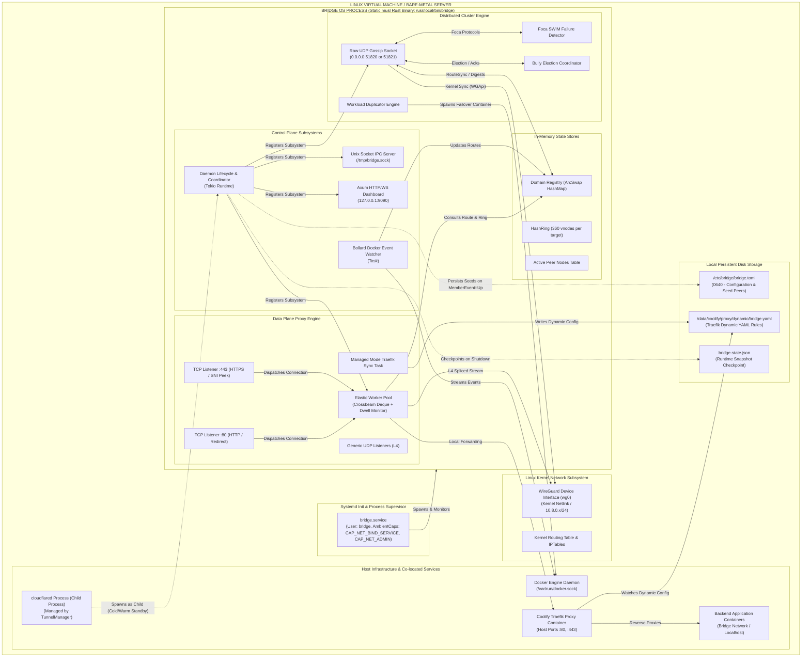

# View B: High-Level Container & Deployment Architecture

## 1. Overview & Runtime Units

BRIDGE is deployed as a single, statically compiled Rust binary running as an unprivileged system daemon (`bridge.service`) under `systemd` across every participating VM in a fleet.

There are no external database dependencies (e.g., PostgreSQL, Redis, etcd, Consul). All state is held in-memory with periodic disk checkpoints and configuration file synchronizations.

---

## 2. Container & Process Deployment Diagram



---

## 3. Technology Inventory & Architectural Role

| Runtime Unit / Technology | Crate / Library | Architectural Role | Network / Storage Boundary |
| :--- | :--- | :--- | :--- |
| **Tokio Asynchronous Engine** | `tokio 1.53` (full) | Multi-threaded async runtime managing all event loops, timers, I/O multiplexing, and task spawning. | Process memory / OS threads |
| **Hyper HTTP Core** | `hyper 1.6`, `hyper-util` | Client connection pooling and HTTP request proxying in Direct Mode (L7). | TCP sockets / Loopback |
| **Crossbeam Deque** | `crossbeam-deque 0.8` | Work-stealing injector, local worker deques, and stealers for elastic concurrency scaling. | In-process lock-free queues |
| **Foca SWIM Gossip Engine** | `foca 2.0` | Decentralized failure detection, direct/indirect heartbeats, and cluster membership tracking. | Raw UDP (`BRDG` datagrams) |
| **WireGuard Netlink Integration** | `defguard_wireguard_rs 0.12` | Creates and configures Linux kernel `wg0` network interface, adds peers, sets AllowedIPs and kernel routes. | Linux Netlink / Kernel space |
| **Cryptography Primitives** | `x25519-dalek 3.0`, `ring 0.17`, `argon2 0.6` | Curve25519 key generation, SHA-256 ring hashing, and Argon2id password hashing. | In-memory CPU operations |
| **Docker Engine Client** | `bollard 0.21` | Communicates over `/var/run/docker.sock` to inspect containers, stream lifecycle events, and spawn replicas. | Local Unix domain socket |
| **Embedded Web Server** | `axum 0.8`, `tower-http 0.6` | Serves dashboard static assets, JSON REST API, and WebSocket live telemetry streams. | Localhost `127.0.0.1:9090` |
| **Configuration & Serialization** | `toml 1.1`, `serde_yaml 0.9`, `serde_json 1.0`, `bincode 1.3` | Parses configuration files, serializes Traefik YAML, saves state checkpoints, and encodes binary UDP packets. | Local filesystem / Network buffers |

---

## 4. Multi-Node Deployment Topology

In a typical production deployment across 3 or more nodes:

```
┌────────────────────────────────────────────────────────────────────────┐
│                        PUBLIC INTERNET / CLIENTS                       │
└────────────────────────────────────┬───────────────────────────────────┘
                                     │
                 ┌───────────────────┴───────────────────┐
                 │ Public DNS / Cloudflare Tunnel Ingress│
                 └───────────────────┬───────────────────┘
                                     ▼
┌────────────────────────────────────────────────────────────────────────┐
│ NODE 1: Ingress Edge Leader (e.g. Hetzner FSN1 - 203.0.113.10)         │
│ • BRIDGE Daemon (Priority: 200, Role: Leader)                          │
│ • Binds Port 80, 443 (Handoff Mode)                                    │
│ • WireGuard Mesh IP: 10.8.0.1 (Interface: wg0)                         │
│ • Raw UDP Gossip Port: 51820                                           │
└───────────────────┬────────────────────────────────┬───────────────────┘
                    │                                │
    Encrypted WireGuard Mesh (10.8.0.1 <-> 10.8.0.2) │ Encrypted WireGuard Mesh (10.8.0.1 <-> 10.8.0.3)
                    │                                │
                    ▼                                ▼
┌──────────────────────────────────────┐ ┌───────────────────────────────┐
│ NODE 2: Worker Follower              │ │ NODE 3: Worker Follower       │
│ (DigitalOcean FRA1 - 203.0.113.11)   │ │ (Vultr AMS - 203.0.113.12)    │
│ • BRIDGE Daemon (Priority: 100)      │ │ • BRIDGE Daemon (Priority: 50)│
│ • WireGuard Mesh IP: 10.8.0.2        │ │ • WireGuard Mesh IP: 10.8.0.3 │
│ • Coolify Proxy (Traefik: 10.8.0.2:443│ │ • Docker App: 10.8.0.3:3000   │
│ • Application: app.example.com       │ │ • Application: api.example.com│
└──────────────────────────────────────┘ └───────────────────────────────┘
```

### Communication Topology
* **Public Ingress:** Handled exclusively by the elected Ingress Leader.
* **Control Plane (SWIM & Gossip):** Full peer-to-peer epidemic mesh over raw UDP (`0.0.0.0:51820`). Every node communicates directly with configured seeds and gossips membership and route digests to random peers (fanout=3).
* **Data Plane (Overlay Interconnect):** Point-to-point peer tunnels over Linux WireGuard interface `wg0` (`10.8.0.0/24`). Traffic routed between nodes travels directly between host kernel interfaces without centralized bottlenecks.
