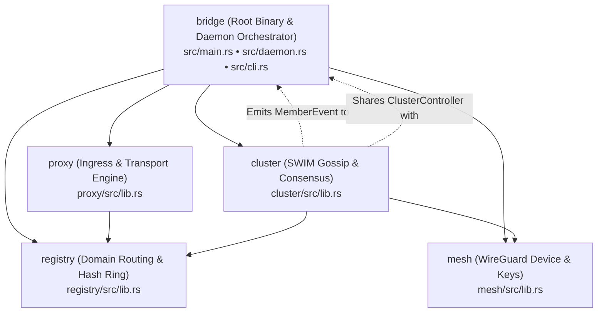
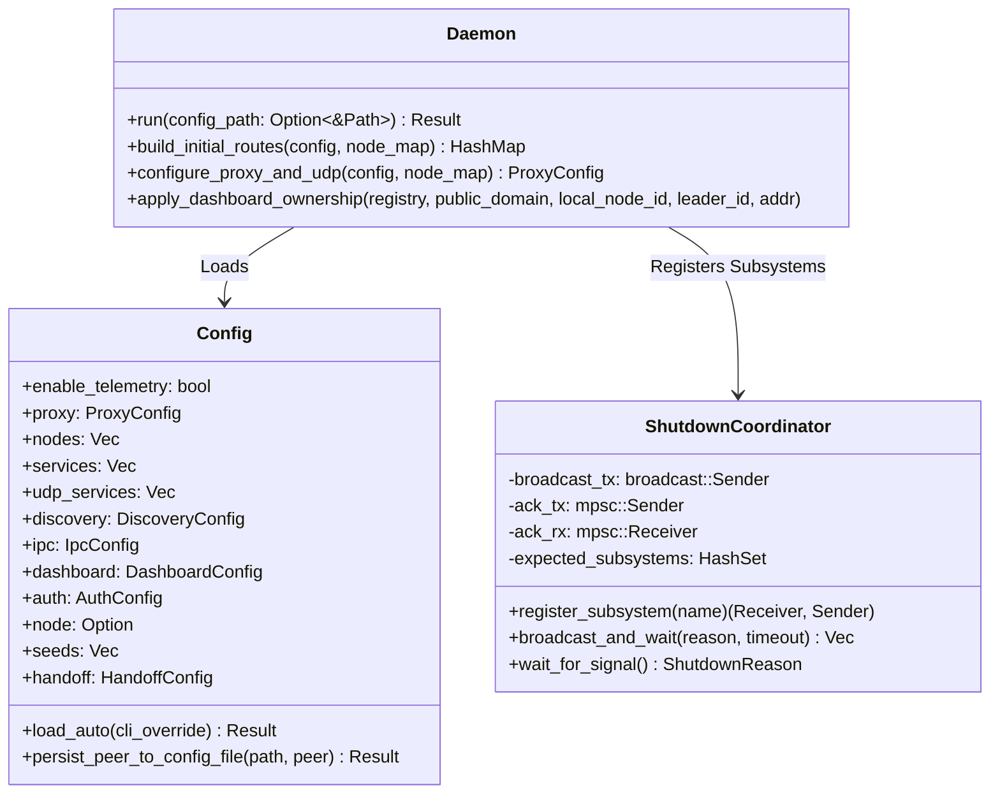
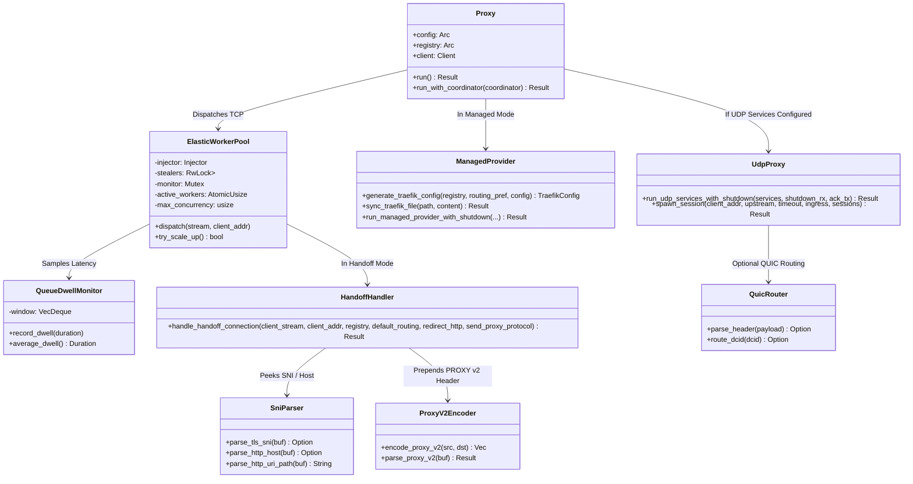
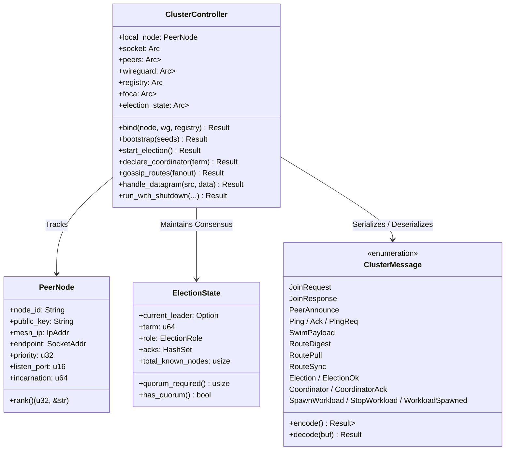
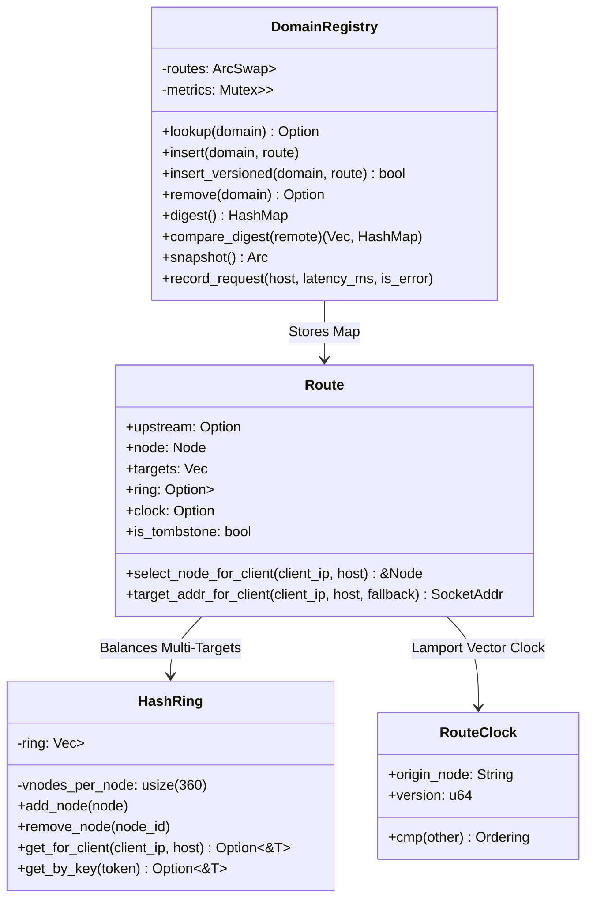
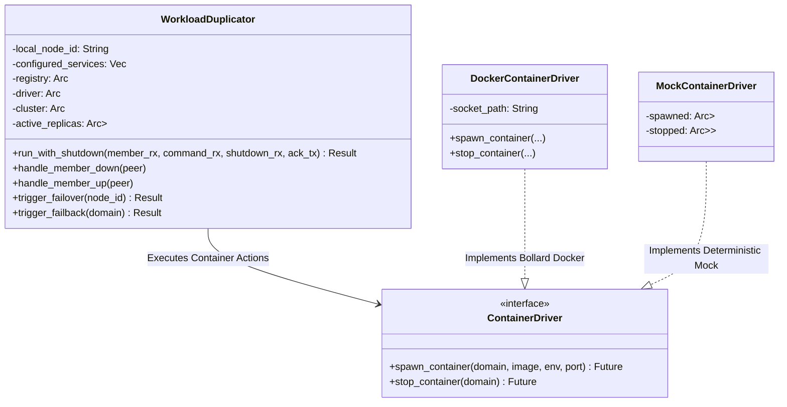

# View C: Internal Component Architecture

## 1. Crate Architecture & Dependency Direction

The repository is structured as a Cargo workspace with four member libraries and one root binary crate:

* **`registry`:** Core data model. Zero internal workspace dependencies. Defines `DomainRegistry`, `Route`, `Node`, `HashRing`, and vector clocks.
* **`mesh`:** Manages WireGuard encryption key generation, peer definitions, and Linux kernel Netlink synchronization via `defguard_wireguard_rs`.
* **`cluster`:** Implements the binary cluster wire protocol (`BRDG`), Foca SWIM failure detection, Bully leader election with dynamic quorum, and push-pull route gossip.
* **`proxy`:** High-performance ingress engine. Implements Direct L7 proxying, Handoff L4 SNI passthrough, Managed Traefik dynamic provider, PROXY protocol v2, UDP/QUIC proxying, and the adaptive elastic worker pool.
* **`bridge` (root):** Application bootstrap orchestrator (`daemon.rs`), administrative CLI (`cli.rs`), IPC control server (`src/ipc`), embedded dashboard (`src/dashboard`), Docker discovery (`src/discovery`), failover duplicator (`src/failover`), ingress handoff managers (`src/handoff`), and self-updater (`src/updater.rs`).

---

## 2. Component Decomposition by Subsystem

### 2.1 Daemon Orchestrator (`bridge`)

### 2.2 Ingress Proxy Engine (`proxy`)

### 2.3 Cluster Coordination & Consensus (`cluster`)

### 2.4 Domain Registry & Consistent Hash Ring (`registry`)

### 2.5 Workload Duplication & Failover (`src/failover`)

