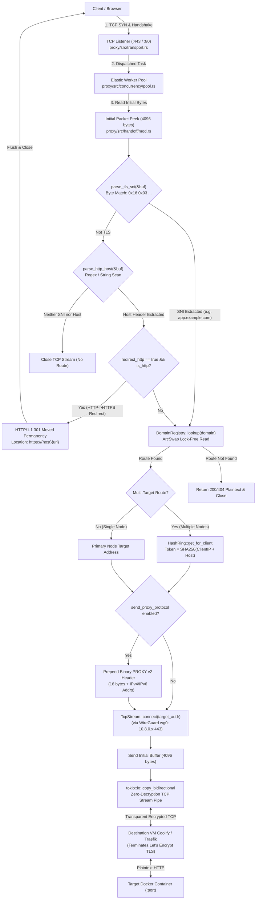
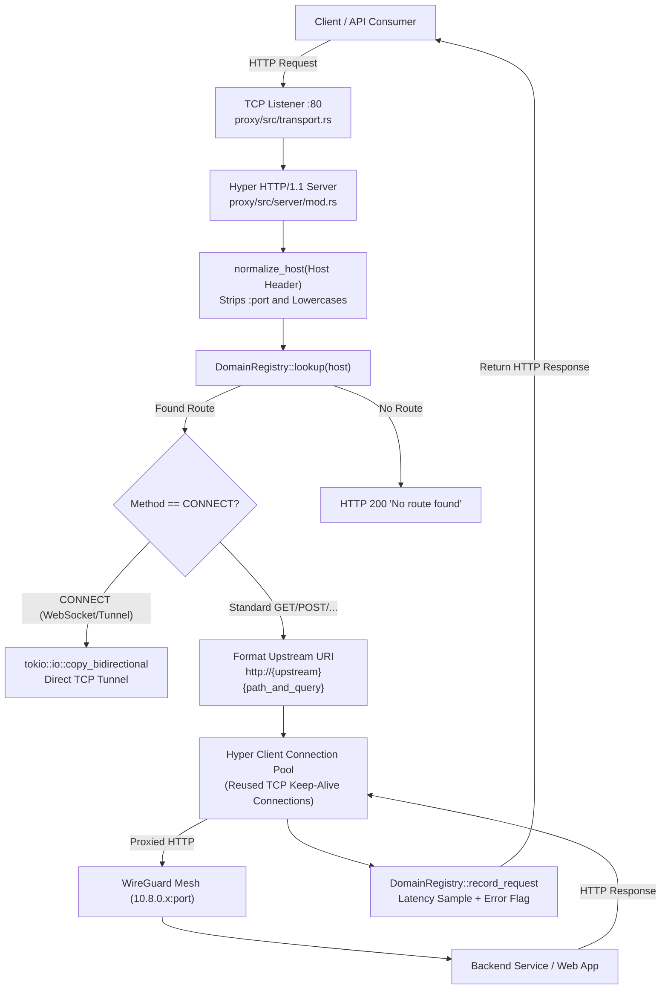
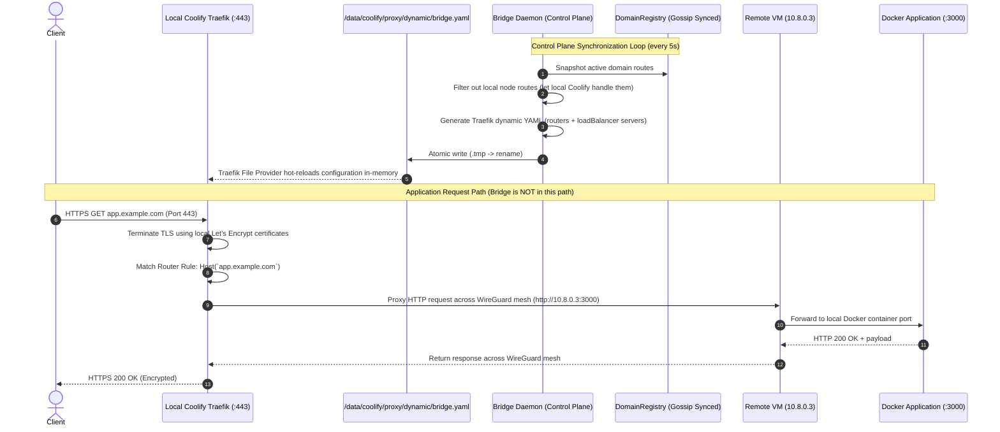
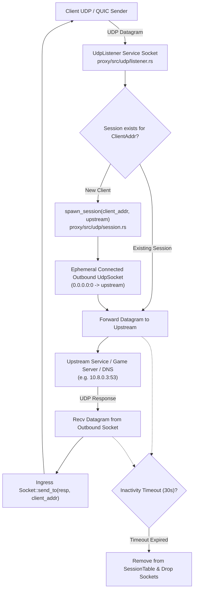

# View D: End-to-End Data Flow Architecture

## 1. Primary Ingress Data Paths

BRIDGE supports three distinct data paths across its operational modes, plus a dedicated L4 UDP data path.

---

## 2. Mode 2: Handoff Mode Data Path (Default L4 SNI Passthrough)

In Handoff mode, Bridge operates at Layer 4. It peeks initial handshake bytes to extract the TLS SNI or HTTP Host header, resolves the target node via consistent hashing, optionally prepends a binary PROXY protocol v2 header, and transparently streams raw TCP payloads across the WireGuard mesh without decrypting TLS.

---

## 3. Mode 1: Direct Mode Data Path (L7 Reverse Proxy)

In Direct mode, Bridge acts as a Layer 7 HTTP reverse proxy. It terminates HTTP connections, inspects request headers, and forwards requests to backend services using Hyper's client connection pool.

---

## 4. Mode 3: Managed Mode Data Path (Traefik Provider Control Plane)

In Managed mode, Bridge is **completely removed from the application data hot path**. Bridge operates purely as a dynamic control-plane provider for Coolify's local Traefik proxy.

---

## 5. Generic L4 UDP & QUIC Data Path

---

## 6. State Mutability & Persistence Classification

| State Entity | Location / Ownership | Persistence Level | Mutability & Synchronization |
| :--- | :--- | :--- | :--- |
| **Domain Routes (`Route`)** | `DomainRegistry` ([`registry/src/lib.rs`](file:///home/peni/Projects/bridge/registry/src/lib.rs)) | In-memory with checkpointing to `bridge-state.json` on shutdown | Mutable via static config, Docker auto-discovery, IPC commands, and gossip `RouteSync`. |
| **Lamport Vector Clocks (`RouteClock`)** | `Route::clock` | In-memory; synced via gossip | Monotonically increasing `(origin_node, version)`. |
| **Peer Nodes (`PeerNode`)** | `ClusterController::peers` | In-memory; seeds persisted to `bridge.toml` | Updated via SWIM `MemberUp`/`MemberDown` and `JoinResponse`. |
| **WireGuard Peers Table** | `WireGuardDevice::peers` | In-memory; synced to kernel `wg0` | Updated when peers are registered or dropped; flushed via Netlink API. |
| **Leader Election Consensus** | `ElectionState` | Transient in-memory | Reset on election cycle; term increments monotonically. |
| **Active Container Replicas** | `WorkloadDuplicator::active_replicas` | Transient in-memory | Spawned on `MemberEvent::Down`; stopped on failback. |
| **Dashboard Session Tokens** | `AuthManager::sessions` | Ephemeral in-memory | Created on login; expires after 24 hours; lost on daemon restart. |
| **User Account Credentials** | `AuthConfig::users` in `bridge.toml` | **Persistent** on disk | Stored as Argon2 PHC hashes in configuration file. |
