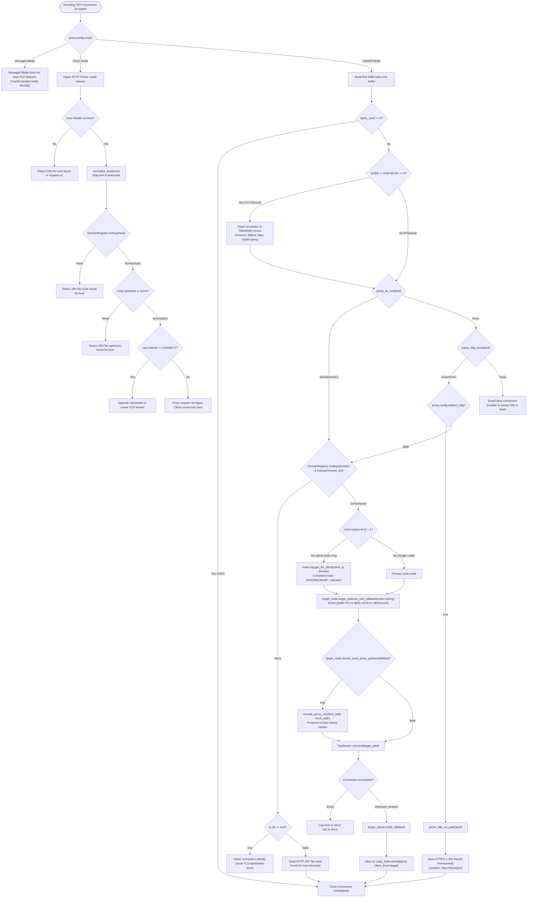
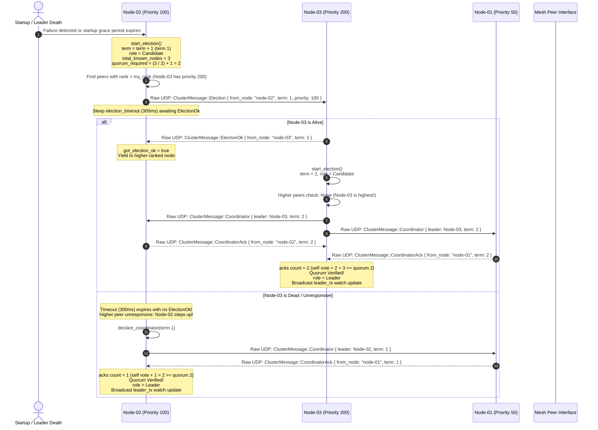
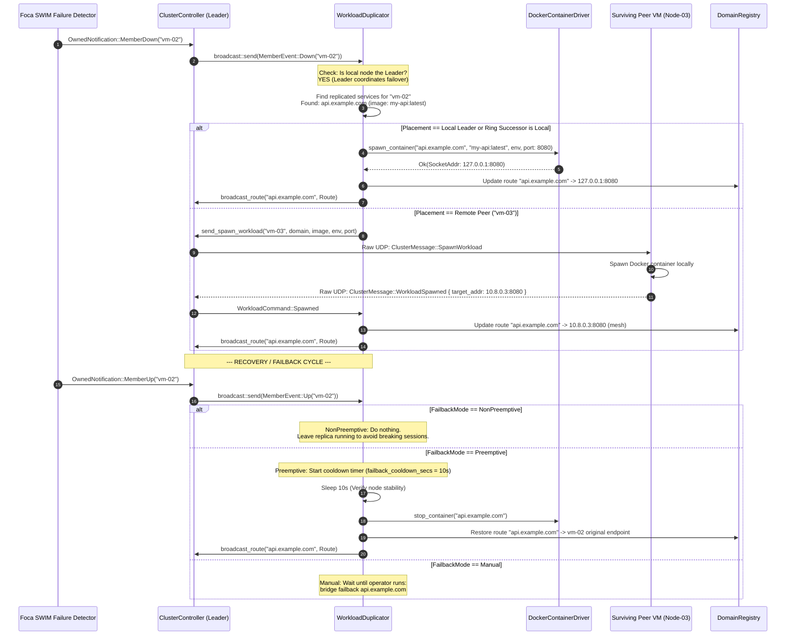

# View E: Control Flow and Decision Gates Architecture

## 1. Overview

This view details the major decision gates, policy branching, guard evaluations, and sequence interactions executed by BRIDGE during connection handling, leader election, and workload failover.

---

## 2. Ingress Connection Dispatch & Routing Decision Flow

---

## 3. Bully Leader Election Sequence

This sequence diagram depicts a node initiating an election round, encountering higher-ranked peers, handling unresponsive nodes, and declaring coordinator leadership upon verified majority quorum.

---

## 4. Leader-Orchestrated Workload Failover & Failback Sequence

