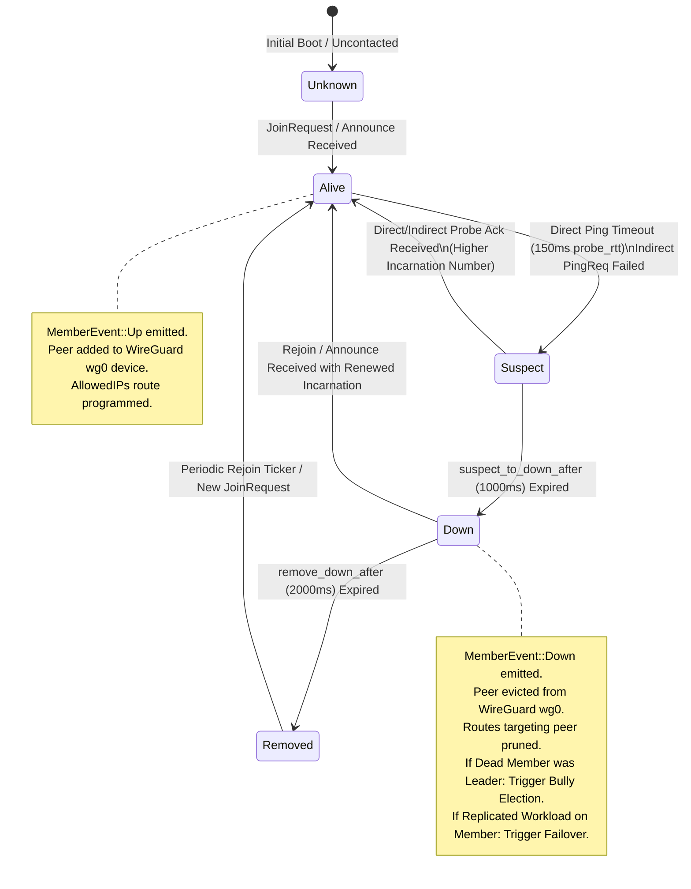
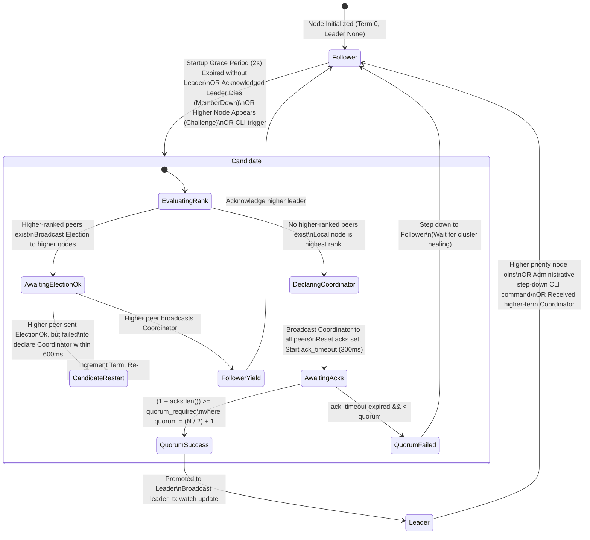

# View F: State Machines and Distributed Coordination Architecture

## 1. Overview

This view documents the state machines governing node lifecycle, failure detection, Bully leader election, and distributed routing table synchronization.

---

## 2. Cluster Node Lifecycle & Failure Detection (Foca SWIM State Machine)

Every node in the cluster is tracked by the Foca SWIM epidemic failure detector through internal membership transitions.



### Invariants & Guards
* **Incarnation Monotonicity:** When a node recovers after being suspected or marked down, it bumps its incarnation number (`incarnation = incarnation + 1`). Incoming gossip messages with lower incarnation numbers are ignored, preventing stale "Down" rumors from poisoning recovered nodes.
* **Rapid Eviction:** Down members are purged from Foca's internal active list after 2 seconds, allowing restarted VMs to quickly rejoin without being rejected as dead.

---

## 3. Bully Leader Election State Machine

The leader election state machine guarantees that across any non-partitioned cluster of $N$ nodes, exactly one node with verified majority quorum acts as cluster coordinator.



### Quorum Formulation & Invariants
$$\text{Quorum Required} = \begin{cases} 
\text{explicit\_override} & \text{if } \text{quorum\_size is set} \\
\left\lfloor \frac{\text{total\_known\_nodes}}{2} \right\rfloor + 1 & \text{otherwise}
\end{cases}$$

* **Single-Node Invariant:** If `total_known_nodes <= 1`, quorum is 1 (self vote). A standalone node assumes leadership trivially without network timeouts.
* **Term Monotonicity:** A node rejects any `Election` or `Coordinator` message whose term is strictly less than its current term.
* **Self-Healing Loop:** Every 5 seconds, if known peers exist but `current_leader == None` (e.g. following a split election), the controller automatically re-runs `start_election()`.

---

## 4. Ingress Handoff Leadership State Machine

Ingress entrypoints (Cloudflare Tunnel and Cloudflare DNS) are strictly bound to cluster leadership state via Tokio `watch::Receiver<Option<PeerNode>>`.

```mermaid
stateDiagram-v2
    [*] --> Standby: Startup

    state Standby {
        ColdStandby: cloudflared process stopped / DNS unchanged
        WarmStandby: cloudflared running continuously on all nodes
    }

    Standby --> PromotedLeader: leader_rx notifies Local Node is Leader

    state PromotedLeader {
        StartTunnel: Spawn child process `cloudflared tunnel run`
        SyncDns: Call Cloudflare API PATCH /zones/{id}/dns_records/{id}\nPoint A-record to local IP
        ActivateDashboardRoute: Insert public dashboard domain into local DomainRegistry
    }

    PromotedLeader --> Standby: leader_rx notifies Local Node is NOT Leader\n(Step down / lost election)

    state StepDownActions {
        KillTunnel: Terminate `cloudflared` child process (SIGKILL / timeout)
        RemoveDashboardRoute: DomainRegistry::remove(public_domain)
    }
```

---

## 5. Workload Replication & Failback State Machine

```mermaid
stateDiagram-v2
    [*] --> Idle: Service Running on Original VM

    Idle --> FailoverTriggered: MemberDown received for service host VM\n(Local node is elected leader)

    state FailoverTriggered {
        SelectPlacement: Consistent hash successor ("ring") / "leader" / explicit
        SpawnContainer: DockerContainerDriver::spawn_container(...)
        UpdateRoute: DomainRegistry route redirected to failover instance
        BroadcastRoute: RouteSync datagram sent to all peers
    }

    FailoverTriggered --> ActiveReplica: Container Running & Serving Ingress Traffic

    ActiveReplica --> MemberRecovered: MemberUp received for original VM

    state MemberRecovered {
        CheckMode: Evaluate failback_mode setting
    }

    CheckMode --> ActiveReplica: NonPreemptive: Do nothing\nKeep replica active
    CheckMode --> CooldownTimer: Preemptive: Start failback cooldown timer (10s)
    CheckMode --> AwaitManual: Manual: Wait for operator CLI command

    CooldownTimer --> RestoreOriginal: Cooldown expired without failure
    AwaitManual --> RestoreOriginal: Operator runs `bridge failback <domain>`

    state RestoreOriginal {
        StopContainer: DockerContainerDriver::stop_container(...)
        RevertRoute: DomainRegistry route reset to original host
        BroadcastRevert: RouteSync datagram sent to all peers
    }

    RestoreOriginal --> Idle: Workload Returned to Original Host
```
