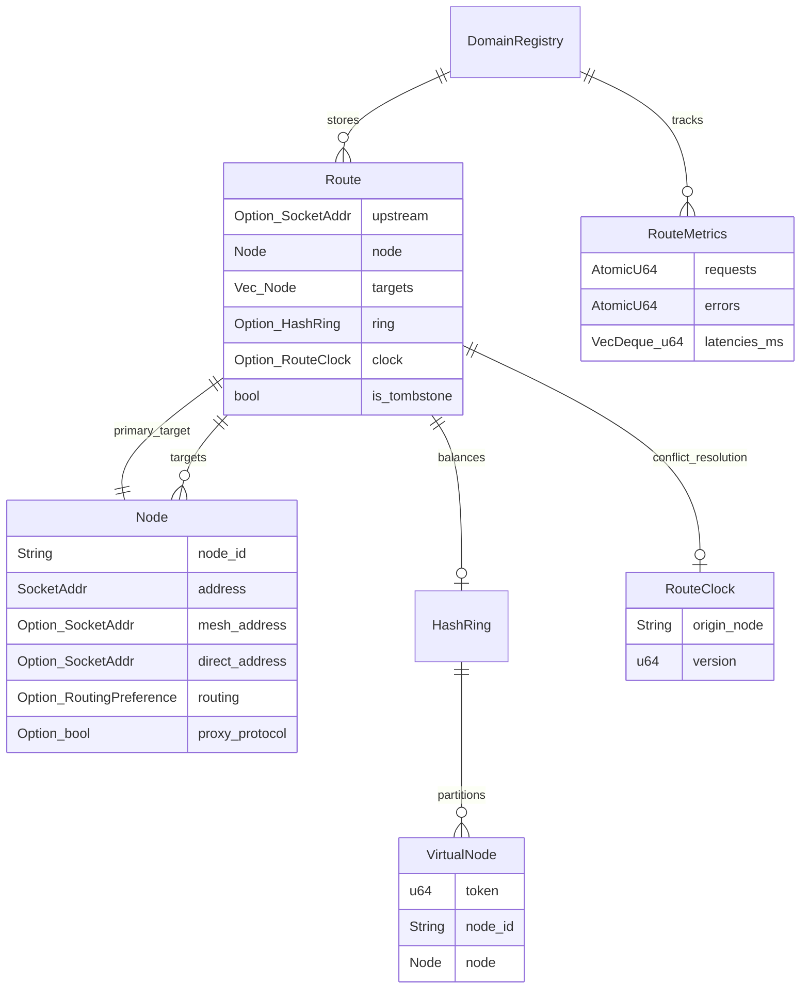

# View G: Database and Persistence Architecture

## 1. Data Store Strategy & Architecture

BRIDGE does not use an external SQL or NoSQL database. Its persistence model is designed for zero operational friction across edge VPS deployments, utilizing:

1. **In-Memory Operational Tables (Hot Path):** Thread-safe, wait-free copy-on-write `ArcSwap` maps and atomic primitives.
2. **Local Configuration Store (Cold Path):** TOML or YAML files (`/etc/bridge/bridge.toml`) with atomic disk writes.
3. **Runtime State Checkpointing:** A JSON or YAML checkpoint file (`bridge-state.json`) written by the `ShutdownCoordinator` during graceful teardown.
4. **Dynamic Traefik Configuration:** Atomic YAML files written for Traefik's dynamic file provider (`/data/coolify/proxy/dynamic/bridge.yaml`).

---

## 2. In-Memory Data Models & Schema (`registry` crate)



### Entity Definitions & Field Semantics

#### `Route`
* **`upstream`:** Optional explicit IP:port override (e.g. `127.0.0.1:3000`). If omitted, routing resolves to the target node's mesh or direct address.
* **`node`:** Primary node hosting the service (used when only one target exists).
* **`targets`:** List of all participating nodes hosting replicas of this domain.
* **`ring`:** Initialized when `targets.len() > 1`. Contains 360 virtual nodes per physical target for consistent hashing and session affinity.
* **`clock`:** Lamport vector clock for conflict resolution in gossip push-pull sync.
* **`is_tombstone`:** Soft-delete marker. Tombstoned routes are skipped by proxy lookups but retained in gossip digests to propagate route deletion across the fleet.

#### `RouteClock`
* **`origin_node`:** Node ID that issued this route version.
* **`version`:** Monotonically increasing counter incremented on every route mutation.
* **Ordering Rule:** `(version, origin_node)` lexicographical comparison.

#### `RouteMetrics`
* **`requests` / `errors`:** Atomic 64-bit counters incremented on every request completion.
* **`latencies_ms`:** Bounded FIFO queue (maximum 512 samples) protected by a Mutex. Provides cheap, bounded P50 and P95 percentile latency calculation for dashboard telemetry.

---

## 3. Persistent File Schemas & Serialization Formats

### 3.1 Runtime Checkpoint Schema (`bridge-state.json`)

Flushed by `spawn_state_finalizer` ([`proxy/src/shutdown.rs:179-261`](file:///home/peni/Projects/bridge/proxy/src/shutdown.rs#L179-L261)) during graceful shutdown.

```json
{
  "timestamp": 1728631200,
  "shutdown_reason": "SIGTERM",
  "proxy_mode": "Handoff",
  "routes_count": 3,
  "routes": {
    "app.example.com": {
      "upstream": "127.0.0.1:3000",
      "node": {
        "node_id": "vm-02",
        "address": "10.8.0.2:443",
        "mesh_address": "10.8.0.2:443",
        "direct_address": "203.0.113.11:443",
        "routing": "mesh",
        "proxy_protocol": true
      },
      "targets": [],
      "ring": null,
      "clock": {
        "origin_node": "vm-02",
        "version": 4
      },
      "is_tombstone": false
    }
  },
  "udp_services": [
    {
      "node_id": "self",
      "listen_port": 5353,
      "listen_addr": "0.0.0.0:5353",
      "upstream": "127.0.0.1:53",
      "session_timeout": 30
    }
  ],
  "status": "gracefully_stopped"
}
```

### 3.2 Configuration File Seed Auto-Persistence (`bridge.toml`)

When a new peer is discovered via raw UDP `JoinRequest` or SWIM `MemberEvent::Up`, the daemon mutates `/etc/bridge/bridge.toml` atomically ([`src/core/config.rs:614-660`](file:///home/peni/Projects/bridge/src/core/config.rs#L614-L660)):

```toml
[[seeds]]
id = "node-02"
endpoint = "203.0.113.11:51820"
public_key = "aB1cD2eF3gH4iJ5kL6mN7oP8qR9sT0uV1wX2yZ3="
mesh_ip = "10.8.0.2"
```

### 3.3 Atomic Write Protocol

All disk modifications in BRIDGE follow the write-to-temporary-and-rename pattern:
1. Serialize payload into memory (TOML, YAML, or JSON).
2. Write payload to hidden temporary file: `.{filename}.{pid}.tmp`.
3. Call `std::fs::rename(tmp_path, target_path)` (guaranteed atomic on POSIX filesystems).
4. If rename fails, remove temporary file and log warning.

This prevents partial or corrupted configuration files if the daemon process terminates abruptly during a disk write.
