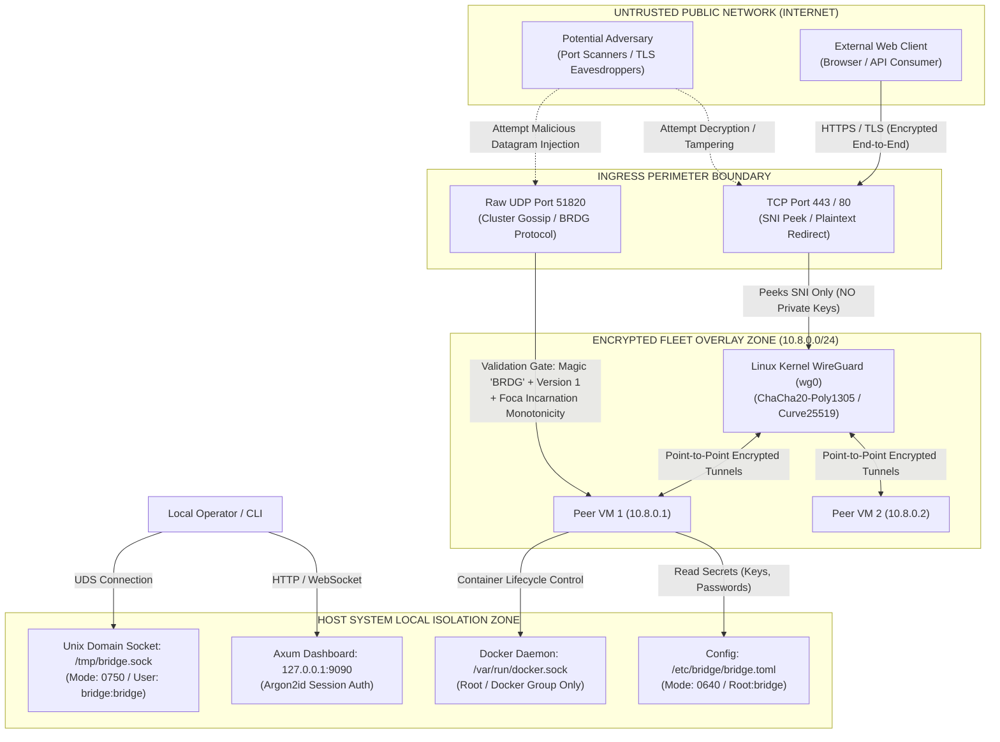

# View I: Security and Trust Boundaries Architecture

## 1. Security Architecture & Threat Model

BRIDGE is designed to operate securely across untrusted public clouds, multi-tenant VPS providers, and heterogeneous bare-metal servers.

Its security posture relies on strict isolation between control and data planes, cryptographic overlay networking, zero-trust inter-node assumptions, and unprivileged daemon execution.

---

## 2. Trust Boundaries Diagram

---

## 3. Implemented Security Controls

### 3.1 Unprivileged Daemon Execution & Linux Ambient Capabilities
* **Operating User:** The installer creates an unprivileged system user (`bridge`) with no home directory and `/usr/sbin/nologin`.
* **Minimal Capabilities:** Rather than running as `root`, the systemd service unit grants only two ambient Linux capabilities:
  * `CAP_NET_BIND_SERVICE`: Permits binding privileged low ports (`80` and `443`).
  * `CAP_NET_ADMIN`: Permits configuring the Linux kernel WireGuard interface (`wg0`), setting IP addresses, and modifying routing tables via Netlink.
* **Process Sandboxing:** `bridge.service` enforces:
  * `NoNewPrivileges=true`
  * `ProtectSystem=full`
  * `LimitNOFILE=65535`

### 3.2 WireGuard Overlay Encryption (Inter-Node Mesh)
* **Cryptographic Standards:** All cross-server application traffic travels exclusively over kernel WireGuard (`wg0`).
* **Primitives:** RFC 7748 Curve25519 key exchange, ChaCha20-Poly1305 authenticated symmetric encryption, and BLAKE2s hashing.
* **Key Generation:** If private keys are unconfigured, Bridge generates fresh RFC 7748 Curve25519 keypairs locally using `x25519_dalek::StaticSecret::random()` with the operating system's CSPRNG.

### 3.3 Zero TLS Termination (Handoff Mode)
* **Private Key Isolation:** In Handoff mode, Bridge does not hold, load, or process customer SSL/TLS certificates or private keys.
* **Data Privacy:** Bridge peeks only the unencrypted TLS `ClientHello` handshake header (bytes 0 to 512) to extract the SNI hostname string. Once the hostname is matched in the registry, the raw TCP stream is spliced bidirectionally. Bridge cannot decrypt or inspect application HTTP requests, session cookies, or user payloads.

### 3.4 In-Memory Dashboard Authentication & Password Hashing
* **Password Storage:** User passwords stored in `bridge.toml` are hashed using the **Argon2id PHC** algorithm with randomized salts via `argon2 0.6`.
* **Timing-Attack Resistance:** When an unknown username attempts login, `AuthManager::login` executes a dummy Argon2 password verification work cycle against a placeholder hash ([`src/auth.rs:110-112`](file:///home/peni/Projects/bridge/src/auth.rs#L110-L112)), preventing username enumeration via response timing differences.
* **Session Management:** Session tokens are 32-byte cryptographically secure random alphanumeric strings. Sessions are stored in memory with a 24-hour expiration TTL and an automatic memory bound (maximum 1,024 active sessions).

### 3.5 Local Filesystem & IPC Socket Permissions
* **Configuration File:** `/etc/bridge/bridge.toml` is owned by `root:bridge` with mode `0640` (read-only to the daemon user, unreadable to world).
* **IPC Socket:** `/tmp/bridge.sock` is restricted to local system users with access to the `bridge` user or root group.

---

## 4. Security Verification Summary

| Security Boundary | Control Mechanism | Source Verification | Status |
| :--- | :--- | :--- | :--- |
| **Edge Ingress** | Zero-copy SNI peek; no TLS termination | [`proxy/src/handoff/mod.rs:57-77`](file:///home/peni/Projects/bridge/proxy/src/handoff/mod.rs#L57-L77) | **Verified** |
| **Inter-Node Mesh** | Curve25519 WireGuard tunnel encryption | [`mesh/src/wireguard.rs:43-75`](file:///home/peni/Projects/bridge/mesh/src/wireguard.rs#L43-L75) | **Verified** |
| **Cluster Protocol** | 4-byte magic + 1-byte version header validation | [`cluster/src/protocol.rs:235-247`](file:///home/peni/Projects/bridge/cluster/src/protocol.rs#L235-L247) | **Verified** |
| **Dashboard Auth** | Argon2id verification with timing attack protection | [`src/auth.rs:104-135`](file:///home/peni/Projects/bridge/src/auth.rs#L104-L135) | **Verified** |
| **Daemon Privilege** | Unprivileged `bridge` user + `CAP_NET_ADMIN` | [`scripts/install.sh:198-208`](file:///home/peni/Projects/bridge/scripts/install.sh#L198-L208) | **Verified** |
| **Auto-Updater** | SHA-256 manifest validation before binary replace | [`src/updater.rs:60-82`](file:///home/peni/Projects/bridge/src/updater.rs#L60-L82) | **Verified** |
| **Direct Mode ACME** | Documented RFC 8555 `instant-acme` | **Not implemented** | **Unimplemented** |
