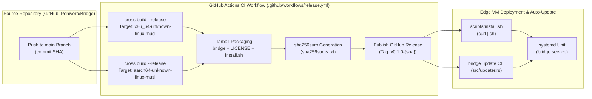
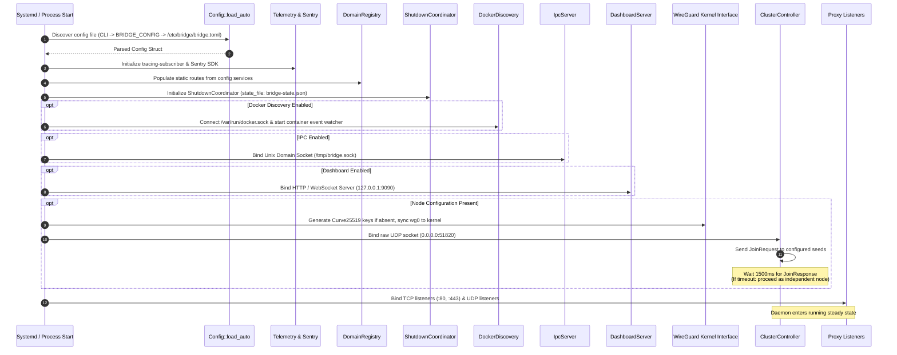
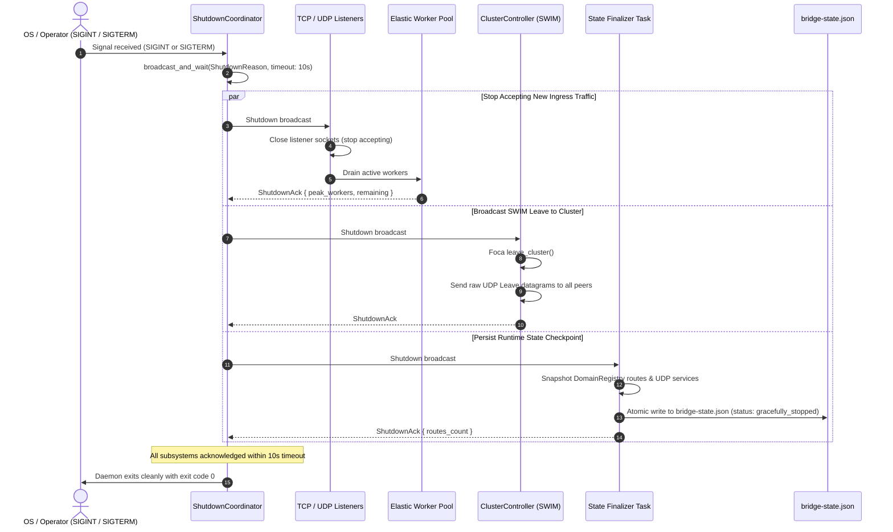

# View J: Deployment, Operations, and Failure Architecture

## 1. Build, Packaging, and CI/CD Pipeline

BRIDGE is built using automated continuous integration in GitHub Actions, targeting fully static Linux binaries with zero glibc or shared library dependencies.

---

## 2. Startup Ordering & Dependency Readiness Gates

When the `bridge` daemon boots (`systemd` start or manual execution), it executes a strict sequential readiness initialization sequence:

---

## 3. Failure Detection, Propagation, and Recovery Matrix

| Failure Event | Detection Mechanism | Time to Detect | System Reaction & Recovery Path | Impact on Ingress Traffic |
| :--- | :--- | :--- | :--- | :--- |
| **Ingress Leader Dies** | SWIM direct ping timeout (150ms) + indirect ping-req failure | $\approx 1000\text{--}1500\text{ms}$ | Surviving nodes initiate Bully election. Highest-priority node declares coordinator, verifies quorum, and assumes leadership. | Traffic to dead leader fails briefly until Cloudflare Tunnel takes over or DNS A-record updates. |
| **Worker VM (Follower) Dies** | SWIM direct probe fails; suspect-to-down timer expires (1000ms) | $1000\text{ms}$ | Controller emits `MemberEvent::Down`. Peer evicted from `wg0`. Ingress leader identifies replicated services and spawns container replicas on surviving nodes. | Multi-target traffic automatically fails over to surviving targets on the hash ring. Replicated services migrate to surviving VM. |
| **Transient Network Flap** | SWIM probe misses 1 ping; suspect state activated | $150\text{ms}$ | Indirect ping-req sent through random peers. If peer answers, node transitions back to `Alive` without triggering failover. | Zero traffic disruption; flapping damped by incarnation counters. |
| **Split-Brain Network Partition** | Bully election quorum guard: `(total / 2) + 1` | $300\text{ms}$ | Minority partition candidates fail quorum verification (`has_quorum == false`) and step down to `Follower`. Only majority partition elects leader. | Prevents split-brain DNS update thrashing. Minority partition stops serving as ingress entrypoint. |
| **Backend Container Dies** | Docker socket event stream emits `die` / `stop` event | $< 50\text{ms}$ | `DockerDiscovery` intercepts event, looks up associated domains, and calls `DomainRegistry::remove(domain)`. Route pruned immediately. | Subsequent connections receive 200 "No route found" or fail over to alternative ring targets. |
| **Daemon Process Abrupt Kill** | Systemd unit watchdog / process exit | Immediate | Systemd restarts daemon after `RestartSec=3`. On boot, daemon loads `bridge-state.json` and config seeds to restore mesh topology. | Temporary pause during the 3-second systemd restart window. |

---

## 4. Graceful Shutdown & Teardown Protocol

